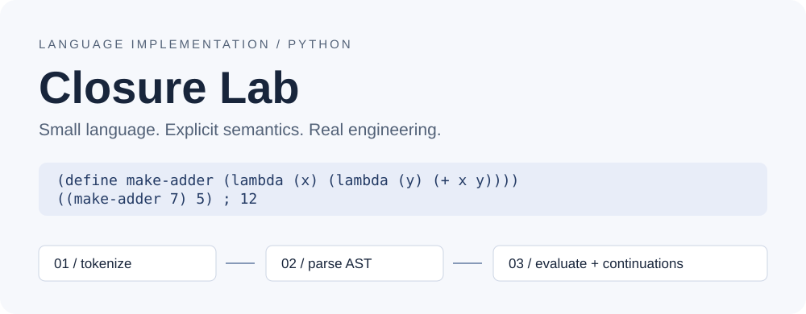

# Closure Lab



**A small Python language implementation focused on lexical scope, closures and explicit evaluation semantics.**

[中文入门](README.zh-CN.md) · [Language reference](docs/language.md) · [Architecture](docs/architecture.md) · [Development story](docs/evolution.md)

This project turns earlier self-study interpreter exercises into an installable, tested engineering portfolio. It implements its own lexer, parser and evaluator: **no Python `eval()` or `exec()`**. It is deliberately small enough to read, reason about and discuss in an interview.

> This is an AI-assisted extension and rewrite, not a claim that every present feature existed in the original exercises. See [the development story](docs/evolution.md) and `NOTICE` for the boundary between historical work and this iteration.

## Highlights

- **Text-to-value pipeline:** tokenize S-expressions, validate forms, build immutable AST nodes and evaluate complete programs.
- **Lexical closures:** higher-order functions, currying, captured environments and explicit shadowing semantics.
- **Named and fixed-point recursion:** `letrec` and an eager Z-combinator example.
- **Stack-safe evaluation:** explicit continuation frames handle both tail and non-tail language recursion without growing the Python call stack.
- **Predictable failure:** strict boolean/integer rules, exact arity, missing-name and zero-division diagnostics with line/column spans.
- **Developer interfaces:** Python API, file/stdin execution, single-line REPL, AST JSON and bounded node traces.
- **Work/size guardrails:** source/token/depth budgets, evaluation steps, integer/string/output limits. These are not a hostile-code security sandbox.
- **Reproducibility:** executable examples, regression tests, typed package, CI configuration and allowlisted release hashing.

## Quick start

Requires Python **3.11+**. Runtime dependencies: **none**. From the repository root:

```bash
python -m pip install -e .
closurelab eval "(+ 20 22)"
closurelab run examples/closures.cl
closurelab run examples/fixed-point.cl --json
closurelab repl
```

If the `closurelab` command is not on your PATH, use `python -m closurelab` instead.

### Closures remember where they were defined

```lisp
(define make-adder (lambda (x) (lambda (y) (+ x y))))
(define add-seven (make-adder 7))
(let (x 1000) (add-seven 5)) ; 12, not 1005
```

Definitions create persistent lexical frames. A closure cannot accidentally pick up a caller's local binding or a name defined later.

### Recursion without Python stack growth

```lisp
(letrec (factorial (lambda (n)
  (if (== n 0) 1 (* n (factorial (- n 1))))))
  (factorial 7)) ; 5040
```

`examples/countdown.cl` makes 2000 recursive calls and returns `0` under the default step budget. Non-tail recursion is also covered by tests. Stack-safe does not mean unlimited or constant-total-memory execution.

### Diagnostics and introspection

```bash
closurelab eval "(// 1 0)"
closurelab ast examples/closures.cl
closurelab run examples/factorial.cl --trace --json
closurelab eval "(+ 1 2)" --max-steps 1
```

Typical error:

```text
<eval>:1:1: E_ZERO: Division by zero
(// 1 0)
^^^^^^^^
```

Normal output prints recorded language output and the final value. `--json` emits one parseable object; trace data contains node types/positions, not closure environments. Errors have stable codes and distinct CLI exit statuses.

## Python API

```python
from closurelab import Limits, execute
from closurelab.runtime import standard_environment

result = execute("(let (x 7) (+ x 5))", trace=True)
assert result.value == 12
assert result.output == ()
print(result.to_data())

# The host chooses whether to persist a successful execution's environment.
first = execute("(define offset 7)")
second = execute("(+ offset 3)", environment=first.environment)
assert second.value == 10

# Input from a trusted embedding host can use explicitly bounded work.
execute("(+ base 2)", environment=standard_environment().extend({"base": 40}),
        limits=Limits(max_steps=100))
```

A custom environment does not automatically contain built-ins; for extensions use `standard_environment().extend(...)` from `closurelab.runtime`. The first API example uses the default built-in environment. A host-provided environment is a trusted interface, not a route for untrusted external objects.

## Language at a glance

| Area | Included |
| --- | --- |
| Primitives | Integers, booleans, Unicode strings, `nil` |
| Functions | First-class lambdas, multiple parameters, exact arity, closures |
| Control | `if`, `begin`, `and`, `or`, `not` |
| Bindings | `let`, single-function `letrec`, top-level `define` |
| Operators | `+ - * // % == != < <= > >=` |
| Built-ins | `len`, `print` |
| Tools | `run`, `eval`, `ast`, `repl`, JSON and trace |

Not included: floating point, mutable variables/collections, module imports, bytecode/JIT compilation, static type inference, general mutual recursion or a multi-line REPL. This is not Python or a full Scheme implementation.

## Verification

```bash
python -m pip install -e ".[dev]"
ruff check .
ruff format --check .
mypy src/closurelab
coverage run -m pytest
coverage report
python -m build
python tools/verify_release.py
```

Coverage includes branches, with a 90% CI threshold. Tests cover language semantics, malformed input, lexical capture, nil/missing distinction, strict bool/int equality, argument order, skipped branches, deep recursion, diagnostics, size budgets, JSON consistency and REPL rollback of definitions.

Local results are recorded in the delivered `closure-lab-verification.json`. The CI matrix targets Python 3.11–3.13 on Linux; its configuration is not proof that GitHub CI has run. No runtime-speed or production-use claims are made.

## Repository layout

```text
src/closurelab/    lexer, parser, AST, runtime, API and CLI
examples/          six executable language examples
tests/             syntax, runtime and command-line regressions
docs/              language, architecture, development story
.github/workflows/ repeatable CI checks
tools/             source-release allowlist and SHA-256 checks
```

Original exercises and `.exe`, `.pdb`, `.class`, IDE metadata, private files and credentials are not redistributed. `tools/verify_release.py` packages only allowed source/doc/example paths and checks ZIP entries against their hashes.

## License

MIT. See [LICENSE](LICENSE) and [NOTICE](NOTICE).
