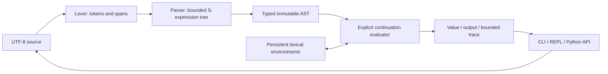

# Architecture and trade-offs

## Module boundaries

- `errors.py`: source spans and stable diagnostic formatting.
- `lexer.py`: consume every input character; JSON string decoding, numeric guardrails, no permissive token skipping.
- `ast.py`: frozen, slot-based nodes and JSON AST inspection.
- `parser.py`: syntax trees lowered to validated language forms; exact special-form arity and binding rules.
- `runtime.py`: explicit-stack evaluation, lexical frames, typed operators, recursion and budgets.
- `api.py`: one-shot `execute()` facade without stdout side effects.
- `cli.py`: file/stdin execution, JSON, trace routing and transactional single-line REPL.
- `tools/verify_release.py`: allowlisted source packaging, credential-pattern scan and hash verification.

## Why an explicit continuation stack?

A recursive Python tree walker is elegant but conflates **language recursion** with the host recursion limit. This evaluator represents pending work with frames: if branches, let bindings, sequence progress, function/argument evaluation and short-circuit logic. Function application changes the current control expression and lexical environment; it does not call `_evaluate()` recursively.

Consequences:

1. A 2000-call countdown does not require modifying `sys.setrecursionlimit`.
2. Non-tail-recursive programs also avoid Python call-stack growth, although their pending frames still consume memory.
3. Tail position naturally reuses the evaluator loop, but this project does not claim constant total memory: environments, results and recorded output can still grow.
4. Each loop transition consumes a step budget, including continuation processing. Steps are a deterministic implementation metric, not CPU instructions or a cross-language benchmark.

## Why persistent environments?

Each frame holds a copied mapping exposed through a read-only proxy and a parent link. Lookup walks parent frames iteratively. A closure captures its definition frame; later definitions produce new frames instead of mutating old closures. This makes shadowing and REPL failure behavior explicit.

`letrec` creates one internal, one-time initialized cell. The closure references a frame containing that cell, so recursive calls can resolve the function without mutating unrelated names. Cycles are handled by Python's garbage collector. This does not implement general mutable variables or mutual recursion.

## Deliberate scope

This is a language-implementation portfolio, not a production compiler or a full Scheme runtime. Text parsing, closures, evaluation order, diagnostics and testing are the central features. No bytecode VM, type inference, module system, mutable collections, external file access or multi-line editor is implied.

Public Python AST/environment constructors are trusted host interfaces. Source guardrails cannot make arbitrary host-created values or a custom output callback safe. For hostile code workloads, add OS/process isolation, wall-clock and memory controls rather than treating this module as a security boundary.

## Development evidence

The test suite checks lexical capture vs dynamic scope, nil vs missing bindings, strict boolean/integer distinction, argument order, short-circuiting, fixed-point recursion, named recursion, deep tail and non-tail calls, source locations, malformed input, budget exhaustion, JSON consistency and REPL environment persistence. Build artifacts are inspected separately for unexpected paths and their ZIP entries are verified by SHA-256.

Local verification records the exact interpreter version; the CI matrix is a proposed repeatable workflow until GitHub actually runs it. No invented speedup or historical production-use claim is made.
